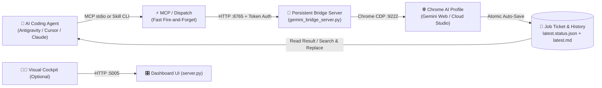

<div align="center">

**🌐 Language:** [🇬🇧 English](./README.md) | [🇹🇭 ภาษาไทย](./README.th.md)

# ⚡ Vertex AI Studio & Gemini Web Bridge (v4.0 OSS)

**Zero-Trust Bridge connecting AI Coding Agents (Antigravity, Cursor, Claude Code) directly to Gemini 4 Web & Google Cloud Studio — Fast, Free, and API-Key-Free.**

[](./CHANGELOG.md)
[](https://www.python.org/)
[](./bridge_mcp_server.py)
[](./gemini_bridge_server.py)
[](./LICENSE)

*Direct Chrome DevTools Protocol (Port 9222 ↔ Bridge Port 8765) • Native MCP Server • Smart Code Bundler (.txt) • Auto-Locale UI (🇹🇭/🇬🇧) • Visual Cockpit Dashboard (Port 5005)*

</div>

---

## 🧭 Architecture Overview (v4.0)



---

## 🌟 What's New in v4.0 & Core Highlights

| Feature | Description |
| :--- | :--- |
| 🔌 **Native MCP Server** | Built-in Model Context Protocol server (`bridge_mcp_server.py`) with 5 standard tools: `ask_argon`, `ask_carbon`, `check_job`, `bridge_status`, and `extract_latest`. |
| ⚡ **Fast Fire-and-Forget** | Dispatches prompts and local file attachments to the browser in under 2 seconds via Persistent Bridge (`:8765`) without blocking the agent. |
| 🎫 **Atomic Job Tickets** | Persists job states (`latest.status.json`) and answers (`latest.md`) using atomic writes (`UUID + fsync`) to prevent file corruption or stale reads. |
| 📦 **Smart Code Bundler** | Consolidates project files into a single `.txt` bundle with 3 modes (`audit`, `feature`, `diff`), reducing token overhead by **40% – 80%**. |
| 🛡️ **Search & Replace Guardrails** | Supports dynamic markdown code fences (4–5 backticks) so nested code blocks and `<<<<<<< SEARCH / ======= / >>>>>>>` patches never break. |
| 🌐 **Auto-Locale UI (TH/EN)** | Automatically detects browser language (`navigator.language`) with an instant `🇹🇭 TH / 🇬🇧 EN` toggle on the Bridge Control Panel. |
| 🎛️ **Visual Cockpit (Optional)** | Side-by-side green/red diff preview dashboard (`server.py` on port `5005`) with Zero-Trust Read/Write scope separation. |

---

## 📦 Quick Installation

### 1. Prerequisites
- **Python 3.10+**
- **Google Chrome**

### 2. Clone & Install Dependencies
```bash
git clone https://github.com/cirrus2026-dev/vertex-studio-oss.git
cd vertex-studio-oss
pip install -r requirements.txt
```

### 3. Environment Configuration (Optional)
```bash
cp .env.example .env
```

---

## 🚀 Quick Start

### Option 1: Headless AI Bridge (Recommended for Antigravity / Cursor / CLI)
Launch an isolated AI Chrome Profile (eliminating repeated "Allow Connection" popups) alongside the Port `8765` Bridge in one click:
```bat
start_ai_bridge.bat
```
Or launch manually:
1. Start Chrome with Remote Debugging (`9222`):
   ```bash
   chrome.exe --remote-debugging-port=9222 --user-data-dir="%USERPROFILE%\.gemini\AI-Chrome-Profile" "https://gemini.google.com/app"
   ```
2. Start the Persistent Bridge Server (`8765`):
   ```bash
   python gemini_bridge_server.py
   ```
   Open the Bridge Control Panel at `http://127.0.0.1:8765` (auto-switches between English & Thai).

---

### Option 2: Connect via Native MCP Server (`bridge_mcp_server.py`)
Add this entry to your AI Coding Agent's `mcp_config.json`:
```json
{
  "mcpServers": {
    "vertex-bridge": {
      "command": "python",
      "args": ["C:/path/to/vertex-studio-oss/bridge_mcp_server.py"]
    }
  }
}
```
**Available MCP Tools:**
- `ask_argon` — Dispatch prompt & files to Gemini Web (Argon)
- `ask_carbon` — Dispatch prompt & files to Google Cloud Studio (Carbon)
- `check_job` — Poll job status and retrieve the saved answer by `job_id`
- `bridge_status` — Inspect Chrome CDP & Bridge health
- `extract_latest` — Extract the latest response directly from the browser DOM

---

### Option 3: Agent Skills (`/ask-argon` & `/ask-carbon`)
Copy `skills/ask-argon` and `skills/ask-carbon` into your agent's skills directory:

| Skill Command | Target Web Interface | Best For |
| :--- | :--- | :--- |
| **`/ask-argon`** | **Gemini Web** (`https://gemini.google.com/app`) | Free everyday web usage, quick code reviews & architecture Q&A |
| **`/ask-carbon`** | **Google Cloud Studio** (`console.cloud.google.com`) | Vertex AI Studio Multimodal / GCP project workflows |

```bash
# Dispatch to Gemini Web (Argon)
python skills/ask-argon/scripts/dispatch.py --prompt "Audit this file for bugs" --files app.py

# Dispatch to Cloud Studio (Carbon)
python skills/ask-carbon/scripts/dispatch_carbon.py --prompt "Design a clean API architecture" --files server.py
```

---

### Option 4: Smart Code Bundler CLI (`bundle_project.py`)
```bash
# 1. Audit Mode: Full implementation (100% code) with whitespace cleanup & secret filtering
python bundle_project.py --dir ./my-project --out bundle.txt --mode audit

# 2. Feature Mode: AST Outline only (Class / Async Def / Function / Docstring) — saves 70-80% tokens
python bundle_project.py --dir ./my-project --out bundle.txt --mode feature

# 3. Diff Mode: Latest Git Diff only — saves up to 95% tokens
python bundle_project.py --dir ./my-project --mode diff
```

---

### Option 5: Visual Cockpit Dashboard (Port 5005)
```bash
python server.py
```
Or double-click `run.bat` on Windows and open `http://localhost:5005`.

---

## 📁 Project Structure

```text
vertex-studio-oss/
├── bridge_mcp_server.py         # Native MCP Server (stdio) with 5 standard tools (v4.0)
├── gemini_bridge_server.py      # Persistent Chrome CDP Bridge Server (Port 8765) + Job API
├── chrome_cdp_fixes.py          # Atomic Auto-Save Watcher, Job Tickets & CDP Hardening
├── chrome_cdp.py                # Core Chrome DevTools Protocol Client + Dynamic Markdown Fence
├── bridge_security.py           # Token Auth & Host/Origin Protection Middleware
├── bundle_project.py            # Smart Code Bundler CLI (Audit, Feature, Diff + Secret Filter)
├── server.py                    # Visual Cockpit Dashboard Server (Port 5005)
├── code_tools.py                # Code Analysis, AST Outline & Mention Parser
├── code_tools_hardening.py      # Atomic Writer, FileLocks, Safe Text & Sensitive Filter
├── index.html                   # Single-Page Visual Cockpit Dashboard UI
├── start_ai_bridge.bat          # One-click AI Chrome Profile + Bridge Port 8765 Launcher (v4.0)
├── run.bat                      # Dashboard Launcher Script
├── skills/                      # Ready-to-use Agent Skills
│   ├── ask-argon/               # Gemini Web Skill (Port 8765 Direct)
│   └── ask-carbon/              # Cloud Studio Multimodal Skill (Port 8765 Direct)
├── .env.example                 # Environment Variable Template
├── requirements.txt             # Python Dependencies
├── CHANGELOG.md                 # Full Release History (up to v4.0.0)
├── README.md                    # English Documentation
└── README.th.md                 # Thai Documentation (เอกสารภาษาไทย)
```

---

## 🛡️ Zero-Trust Security Assurance

- **Localhost Bound:** Binds strictly to `127.0.0.1` — no external network exposure.
- **Middleware Token & Origin Guard:** Protects against CSRF and localhost exploits using `X-Bridge-Token` and `Host/Origin` allowlists.
- **Sensitive Pattern Filter:** Automatically excludes `.env`, `*.key`, `*.pem`, `.bridge_token*`, and `sessions_store.json` from code bundles.
- **Atomic File Writes:** Uses temp UUID files + `os.fsync()` with retry logic to prevent data corruption.
- **Pre-Release Privacy Audited:** Verified clean with zero hardcoded personal paths, project IDs, emails, or credentials.

---

## 📄 License

Released under the **MIT License** — free to use, modify, and distribute.
