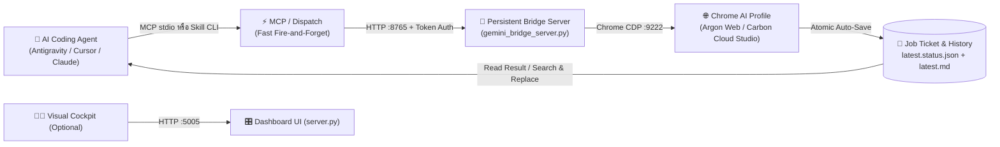

<div align="center">

**🌐 Language:** [🇬🇧 English](./README.md) | [🇹🇭 ภาษาไทย](./README.th.md)

# ⚡ Vertex AI Studio & Gemini Web Bridge (v4.0 OSS)

**ระบบสะพานเชื่อม AI Coding Agents (Antigravity, Cursor, Claude Code) สู่ Gemini 4 Web & Google Cloud Studio — ฟรี รวดเร็ว ปลอดภัยแบบ Zero-Trust**

[](./CHANGELOG.md)
[](https://www.python.org/)
[](./bridge_mcp_server.py)
[](./gemini_bridge_server.py)
[](./LICENSE)

*เชื่อมตรงผ่าน Chrome DevTools Protocol (Port 9222 ↔ Bridge Port 8765) • รองรับ Native MCP • Smart Code Bundler (.txt) • Visual Cockpit Dashboard (Port 5005)*

</div>

---

## 🧭 ภาพรวมสถาปัตยกรรม (v4.0 Architecture)



---

## 🌟 จุดเด่นในเวอร์ชัน 4.0 (What's New & Core Highlights)

| ความสามารถ | รายละเอียด |
| :--- | :--- |
| 🔌 **Native MCP Server** | เชื่อมต่อผ่าน Model Context Protocol (`bridge_mcp_server.py`) พร้อม 5 เครื่องมือมาตรฐาน (`ask_argon`, `ask_carbon`, `check_job`, `bridge_status`, `extract_latest`) |
| ⚡ **Fast Fire-and-Forget** | ส่งคำสั่งและแนบไฟล์เข้าหน้าเว็บได้ในเสี้ยววินาทีผ่าน Persistent Bridge (พอร์ต `8765`) โดยไม่ค้างบล็อกหน้าต่างทำงาน |
| 🎫 **Atomic Job Tickets** | บันทึกสถานะงาน (`latest.status.json`) และคำตอบ (`latest.md`) แบบ Atomic Write (`UUID + fsync`) หมดปัญหาไฟล์พังหรืออ่านคำตอบเก่าซ้ำ |
| 📦 **Smart Code Bundler** | สกัดโค้ดทั้งโปรเจกต์เป็น `.txt` ก้อนเดียวพร้อม 3 โหมด (`audit`, `feature`, `diff`) ช่วยลด Token Overhead ได้ **40% – 80%** |
| 🛡️ **Search & Replace Guardrails** | รองรับ Dynamic Code Fence (4–5 backticks) ป้องกันบล็อกแก้โค้ดแตกหักเมื่อนำไปใช้กับเครื่องมือแก้ไขไฟล์ |
| 🎛️ **Visual Cockpit (Optional)** | แดชบอร์ดตรวจสอบ Diff สีเขียว-แดง (`server.py` พอร์ต `5005`) พร้อม Zero-Trust Read/Write Scope Separation |

---

## 📦 การติดตั้ง (Quick Installation)

### 1. ความต้องการของระบบ
- **Python 3.10** ขึ้นไป
- **Google Chrome**

### 2. โคลนโปรเจกต์และติดตั้ง Dependencies
```bash
git clone https://github.com/cirrus2026-dev/vertex-studio-oss.git
cd vertex-studio-oss
pip install -r requirements.txt
```

### 3. ตั้งค่าสภาพแวดล้อม (Optional)
```bash
cp .env.example .env
```

---

## 🚀 วิธีเริ่มต้นใช้งาน (Quick Start)

### วิธีที่ 1: โหมด Headless AI Bridge (แนะนำสำหรับ Antigravity / Cursor / CLI)
เปิด Chrome โปรไฟล์แยกสำหรับ AI (เพื่อไม่ให้เด้งถามสิทธิ์ Allow Connections ซ้ำ) พร้อมรันท่อ `8765` ในคลิกเดียว:
```bat
start_ai_bridge.bat
```
หรือเปิดแบบ Manual ทีละขั้นตอน:
1. เปิด Chrome ด้วยพอร์ต Debugging `9222`:
   ```bash
   chrome.exe --remote-debugging-port=9222 --user-data-dir="%USERPROFILE%\.gemini\AI-Chrome-Profile" "https://gemini.google.com/app"
   ```
2. เปิดเซิร์ฟเวอร์สะพานเชื่อม (`8765`):
   ```bash
   python gemini_bridge_server.py
   ```
   ตรวจสอบสถานะและทดสอบส่งข้อความได้ที่หน้าเว็บ: `http://127.0.0.1:8765`

> 💡 **Pro Tip (Windows Background Task):** หากต้องการให้ท่อ `8765` เปิดสแตนด์บายอิสระโดยไม่ค้างสถานะ Background Task ใน Agent สามารถลงทะเบียนผ่าน Windows Task Scheduler ชื่อ `GeminiBridgeService` เพื่อเรียกผ่าน `schtasks /run /tn "GeminiBridgeService"`

---

### วิธีที่ 2: เชื่อมต่อผ่าน Native MCP Server (`bridge_mcp_server.py`)
เพิ่มคอนฟิกลงใน `mcp_config.json` ของ AI Coding Agent ที่คุณใช้งาน:
```json
{
  "mcpServers": {
    "vertex-bridge": {
      "command": "python",
      "args": ["C:/path/to/vertex-studio-oss/bridge_mcp_server.py"]
    }
  }
}
```
**เครื่องมือที่พร้อมใช้งานทันทีผ่าน MCP:**
- `ask_argon` — ส่งคำถามและแนบไฟล์ไปที่ Gemini Web (Argon)
- `ask_carbon` — ส่งคำถามและแนบไฟล์ไปที่ Google Cloud Studio (Carbon)
- `check_job` — เช็กสถานะและรอรับคำตอบจาก `job_id`
- `bridge_status` — ตรวจสอบสถานะการเชื่อมต่อ Chrome CDP
- `extract_latest` — ดึงคำตอบล่าสุดจาก DOM หน้าเว็บมาบันทึกเป็น Markdown

---

### วิธีที่ 3: ใช้งาน Agent Skills (`/ask-argon` & `/ask-carbon`)
คัดลอกโฟลเดอร์ `skills/ask-argon` และ `skills/ask-carbon` ไปวางในโฟลเดอร์ Skills ของ Agent เพื่อเรียกใช้งานด้วยคำสั่งสั้นๆ เช่น:
```bash
# ส่งงานให้ Gemini Web (Argon)
python skills/ask-argon/scripts/dispatch.py --prompt "ช่วยวิเคราะห์หาบั๊กในไฟล์ที่แนบ" --files app.py

# ส่งงานให้ Cloud Studio (Carbon)
python skills/ask-carbon/scripts/dispatch_carbon.py --prompt "ออกแบบโครงสร้าง API ใหม่" --files server.py
```

---

### วิธีที่ 4: Smart Code Bundler CLI (`bundle_project.py`)
สกัดโค้ดทั้งโปรเจกต์เป็น `.txt` ไฟล์เดียวก่อนแนบส่งเข้าหน้าเว็บ:
```bash
# 1. โหมด Audit: สกัดโค้ดตัวเต็ม 100% ตัดเฉพาะบรรทัดว่างและกรองไฟล์ความลับอัตโนมัติ
python bundle_project.py --dir ./my-project --out bundle.txt --mode audit

# 2. โหมด Feature: สกัดเฉพาะโครงร่าง AST (Class / Async Def / Function / Docstring) ลดโทเค็น 70-80%
python bundle_project.py --dir ./my-project --out bundle.txt --mode feature

# 3. โหมด Diff: ดึงเฉพาะส่วนที่แก้ไขล่าสุดจาก Git Diff ลดโทเค็นถึง 95%
python bundle_project.py --dir ./my-project --mode diff
```

---

### วิธีที่ 5: โหมด Visual Cockpit Dashboard (Port 5005)
สำหรับผู้ที่ต้องการหน้าจอควบคุม พร้อมดูตัวอย่าง Diff เขียว-แดงก่อนเขียนทับไฟล์:
```bash
python server.py
```
หรือดับเบิลคลิก `run.bat` บน Windows แล้วเปิดเบราว์เซอร์ไปที่ `http://localhost:5005`

---

## 📁 โครงสร้างโปรเจกต์ (Project Structure)

```text
vertex-studio-oss/
├── bridge_mcp_server.py         # Native MCP Server (stdio) 5 เครื่องมือมาตรฐาน (v4.0)
├── gemini_bridge_server.py      # Persistent Chrome CDP Bridge Server (Port 8765) + Job API
├── chrome_cdp_fixes.py          # Atomic Auto-Save Watcher, Job Tickets & CDP Hardening
├── chrome_cdp.py                # Core Chrome DevTools Protocol Client + Dynamic Markdown Fence
├── bridge_security.py           # Token Auth & Host/Origin Protection Middleware
├── bundle_project.py            # Smart Code Bundler CLI (Audit, Feature, Diff + Secret Filter)
├── server.py                    # Visual Cockpit Dashboard Server (Port 5005)
├── code_tools.py                # Code Analysis, AST Outline & Mention Parser
├── code_tools_hardening.py      # Atomic Writer, FileLocks, Safe Text & Sensitive Filter
├── index.html                   # Single-Page Visual Cockpit Dashboard UI
├── start_ai_bridge.bat          # คลิกเดียวเปิด Chrome โปรไฟล์ AI + Bridge Port 8765 (v4.0)
├── run.bat                      # สคริปต์รันระบบ Dashboard
├── skills/                      # ชุด Agent Skills พร้อมใช้งาน
│   ├── ask-argon/               # สกิลสำหรับ Gemini Web (Port 8765 Direct)
│   └── ask-carbon/              # สกิลสำหรับ Cloud Studio Multimodal (Port 8765 Direct)
├── .env.example                 # ตัวอย่างไฟล์ Environment Variables
├── requirements.txt             # รายการ Python Dependencies
├── CHANGELOG.md                 # ประวัติการอัปเดตทุกรุ่น (ถึง v4.0.0)
└── README.md                    # เอกสารคู่มือการใช้งาน
```

---

## 🛡️ มาตรฐานความปลอดภัย (Zero-Trust Security Assurance)

- **Localhost Only:** ผูก Binding เฉพาะ `127.0.0.1` ปิดกั้นการเข้าถึงจากภายนอกเครือข่าย
- **Middleware Token & Origin Guard:** ป้องกัน CSRF และ Localhost Exploit ด้วย `X-Bridge-Token` และ `Host/Origin` Whitelist
- **Sensitive Pattern Filter:** ระบบมัดรวมไฟล์กรองไฟล์ความลับ (`.env`, `*.key`, `*.pem`, `.bridge_token*`, `sessions_store.json`) ออกโดยอัตโนมัติ
- **Atomic File Writes:** บันทึกคำตอบและไฟล์แก้ไขด้วย Temp UUID + `os.fsync()` พร้อม Retry ป้องกันไฟล์เสียหาย
- **Pre-Release Privacy Audited:** ตรวจสอบแล้วว่าปราศจาก Path ส่วนตัว, Project ID, Email หรือ Credential ใดๆ

---

## 📄 สิทธิ์การใช้งาน (License)

เผยแพร่ภายใต้สัญญาอนุญาต **MIT License** — สามารถนำไปใช้งาน พัฒนาต่อยอด และปรับแต่งได้ตามต้องการ
